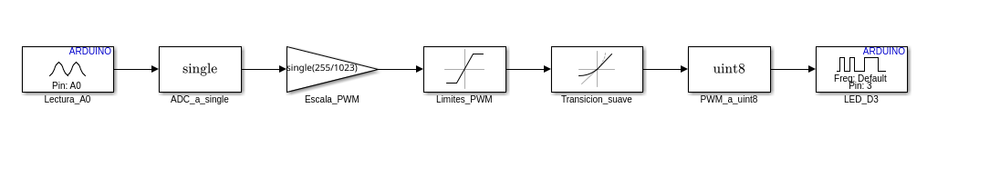

# Transiciones suaves y cambio de firmware

Esta variante limita la velocidad de cambio del mando PWM sin cambiar el
cableado: potenciometro en A0 y LED con resistencia en D3. No es un filtro
pasabajos ni un cambio de la frecuencia portadora del PWM.

## 1. Conservar las dos versiones

| Version | Modelo | Firmware para cargar |
| --- | --- | --- |
| Respuesta directa original | [pot_led.slx](../model/pot_led.slx) | [pot_led.hex](../firmware/pot_led.hex) |
| Transicion suave | [pot_led_suave.slx](../model/pot_led_suave.slx) | [pot_led_suave.hex](../firmware/pot_led_suave.hex) |

Los dos modelos y sus HEX/ELF ya estan generados. No es necesario crearlos otra
vez para probarlos. El modelo y los binarios originales conservan sus hashes.
El Uno ejecuta un solo firmware: alternar implica volver a cargar el HEX
elegido, no pulsar un interruptor ni conservar dos programas ejecutandose.

## 2. Entender el cambio en Simulink

Abre la variante desde MATLAB, con el repositorio como carpeta actual:

```matlab
open_system(fullfile(pwd, 'model', 'pot_led_suave.slx'));
```

El algoritmo queda asi:



El bloque nuevo es **Simulink > Discontinuities > Rate Limiter**. Se coloca
despues de `Limites_PWM` y antes de `PWM_a_uint8`, para trabajar con el mando
en punto flotante antes de cuantizarlo.

| Parametro | Valor |
| --- | --- |
| Rising slew rate | `single(100)` |
| Falling slew rate | `single(-100)` |
| Sample time mode | `inherited` |
| Initial condition | `single(0)` |
| Paso del modelo y muestreo de A0 | `0.01` s, sin cambiar |

Los limites se expresan en niveles PWM por segundo, no en Hz. Cada 10 ms puede
cambiar como maximo un nivel: `100 * 0.01 = 1`. El recorrido completo de 0 a 255
tarda aproximadamente 2.55 s (255 actualizaciones). Si el objetivo esta mas
cerca, llega antes; si inviertes el potenciometro, la rampa invierte su sentido.
Al reiniciar, el estado anterior vale cero y tambien se limita el arranque.

La salida sigue entre 0 y 255. La portadora PWM conserva la configuracion del
soporte Arduino; variar lentamente el ciclo util no equivale a una portadora
de 100 Hz. Tampoco se presupone una relacion lineal entre ciclo util y brillo
percibido.

### Como reproducir la modificacion

En una copia de trabajo donde no exista la variante, puedes abrir el modelo
original y usar **Save As** para guardarlo como `pot_led_suave.slx`. Despues,
interrumpe la conexion `Limites_PWM -> PWM_a_uint8`, inserta el Rate Limiter
con la tabla anterior, reconecta y guarda la variante. No guardes esos cambios
sobre `pot_led.slx`.

La alternativa reproducible es ejecutar, con ambos modelos cerrados:

```matlab
addpath(fullfile(pwd, 'scripts'));
preparar_modelo_suave();
```

El [script](../scripts/preparar_modelo_suave.m) no sobrescribe una variante
existente y no guarda modificaciones en el original. Si indica que ya existe,
abre ese modelo; no necesitas borrarlo ni repetir la creacion.

## 3. Probar y compilar la variante

Guarda y cierra el modelo antes de estos comandos:

```matlab
addpath(fullfile(pwd, 'scripts'));
addpath(fullfile(pwd, 'tests'));
test_transicion_suave();
resultado = compilar_modelo([], 'pot_led_suave');
disp(resultado);
```

La [prueba](../tests/test_transicion_suave.m) copia los bloques del algoritmo a
un banco sin hardware y verifica cinco secuencias: cero, maximo desde el
arranque, bajada desde maximo, valor intermedio e inversion antes de completar
la rampa. Compara cada muestra con la respuesta esperada y limita el cambio a
un nivel por muestra. Estos criterios son para 100 niveles/s; cambiarlos
requiere actualizar tambien la especificacion de la prueba.

`compilar_modelo([], 'pot_led_suave')` publica unicamente los HEX/ELF con ese
nombre. No carga una placa. No ejecutes `compilar_modelo()` sin argumentos para
generar esta variante: la llamada sin argumentos sigue destinada al original.

## 4. Cargar la transicion suave

Desde la terminal Linux situada en la raiz del repositorio, comprueba el puerto:

```bash
python3 scripts/cargar_hardware.py --listar-puertos
```

En este equipo el Uno se detecto como `/dev/ttyUSB0`; reemplaza ese valor si
cambia. Cierra otros programas que usen el puerto. Primero verifica sin escribir:

```bash
python3 scripts/cargar_hardware.py --puerto /dev/ttyUSB0 --firmware firmware/pot_led_suave.hex --comprobar
```

Despues carga la variante y confirma escribiendo `CARGAR`:

```bash
python3 scripts/cargar_hardware.py --puerto /dev/ttyUSB0 --firmware firmware/pot_led_suave.hex
```

El cargador muestra la ruta y el SHA-256 antes de pedir confirmacion. La opcion
`--firmware` no copia ni renombra archivos: solo selecciona el HEX que escribira.
No ejecutes el cargador con `sudo`. El ELF no es el archivo de carga de esta ruta.

## 5. Comprobar en la placa

1. Lleva el potenciometro al minimo y espera a que el LED se apague.
2. Giralo rapidamente al maximo: el brillo debe subir progresivamente durante
   unos 2.55 s, no saltar directamente al maximo.
3. Giralo rapidamente al minimo: debe bajar progresivamente.
4. Elige un valor intermedio: debe estabilizarse sin continuar cambiando.
5. Invierte el giro durante la rampa: la salida debe cambiar de sentido sin
   un salto grande del mando PWM.
6. Pulsa RESET con el potenciometro alto: debe volver a subir desde el estado
   inicial. Repite tras desconectar y reconectar USB.

Con el osciloscopio, compara la evolucion del ciclo util de D3 y mide la
portadora en un punto intermedio. Con 0% o 100% de ciclo util no hay flancos
periodicos con los que medir su frecuencia. Registrar observaciones y valores
reales; una compilacion correcta no sustituye esta prueba.

## 6. Volver al firmware original

```bash
python3 scripts/cargar_hardware.py --puerto /dev/ttyUSB0 --firmware firmware/pot_led.hex
```

Confirma de nuevo `CARGAR`. Tambien puedes omitir `--firmware`: el valor
predeterminado sigue siendo el HEX original. Repite las mismas maniobras del
potenciometro para comparar la respuesta directa y la limitada.

## Comparacion opcional en Wokwi

Deten el simulador. Para una prueba local de la variante, cambia unicamente
estas dos rutas en [wokwi.toml](../wokwi_emulation/wokwi.toml):

```toml
firmware = "../firmware/pot_led_suave.hex"
elf = "../firmware/pot_led_suave.elf"
```

Guarda y reinicia el simulador. Para volver, restaura las rutas a `pot_led.hex`
y `pot_led.elf`. Conserva la configuracion original al terminar: es la referencia
del tutorial y de las pruebas actuales de CI. No cambies el diagrama electrico.

## Estado comprobado y CI

- Modelo suave creado y cinco casos simulados correctamente en MATLAB R2026b.
- Firmware compilado: 5236 bytes de programa y 303 bytes de RAM estatica.
- Selector de firmware: 18 pruebas Python correctas, con `avrdude` simulado.
- `--comprobar` con el HEX suave y `/dev/ttyUSB0`: `PREPARADO`, sin abrir el puerto.
- Modelo, HEX y ELF originales preservados por comparacion de SHA-256.
- No se ha cargado la variante en la placa ni comprobado visualmente en Wokwi
  durante esta preparacion. Esas comprobaciones quedan para los pasos anteriores.

El [CI existente](ci.md) sigue exportando y recompilando **pot_led**, no ambos
modelos. `exportar_ci()` continua siendo la orden del modelo original. Los
cambios del cargador si entran en sus pruebas Python, pero la prueba MATLAB
anterior no se ejecuta en GitHub. Incorporar la variante al build de Actions
requiere parametrizar la exportacion y separar sus manifiestos; no debe
interpretarse el CI del original como validacion automatica del modelo suave.