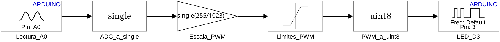
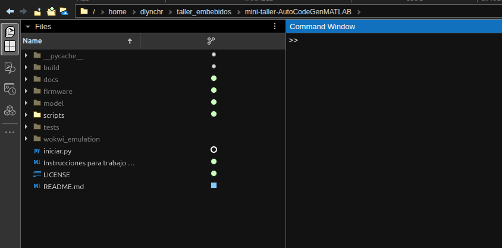
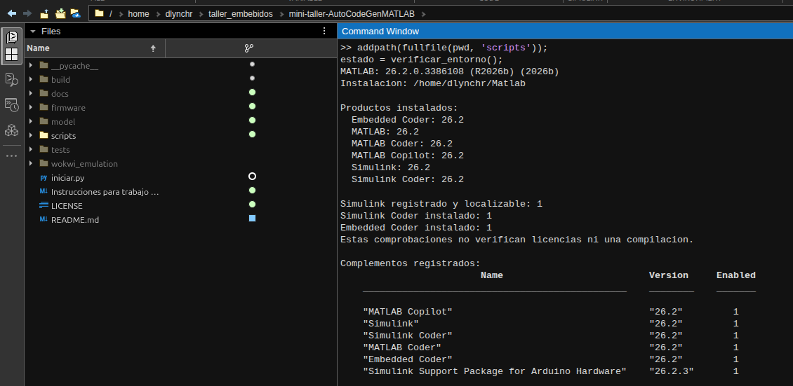

# Tutorial detallado: de Simulink a Wokwi

Este mini-taller está preparado para **Linux x86-64**.

En este ejercicio un potenciómetro conectado a A0 regula el brillo de un LED
conectado a D3 mediante PWM en un Arduino Uno R3. El diagrama de Simulink se
convierte en código C/C++, se compila para el ATmega328P y el archivo resultante
se ejecuta en un circuito virtual. **No hace falta una placa física.**

Puedes seguir una de estas dos rutas:

| Ruta | Qué harás | Requisitos |
| --- | --- | --- |
| A: firmware incluido | Comprobar archivos, abrir Wokwi y experimentar | Python 3.11+, VS Code, Internet y activación Wokwi |
| B: generar con MATLAB | Completar la instalación de MATLAB, inspeccionar el modelo, generar código y compilar; después seguir la ruta A | Lo anterior, MATLAB instalado con acceso a los productos MathWorks necesarios |

La ruta A es suficiente para trabajar con el circuito. Si eliges la B, empieza
por el [paso 1](#1-preparar-matlab-solo-ruta-b) y continúa hasta Wokwi. No tienes
que instalar MATLAB para usar los archivos de firmware incluidos.

## Qué vas a aprender

El Uno digitaliza la tensión del potenciómetro: una lectura entre 0 y 1023
(10 bits). El modelo convierte esa lectura en un valor de control entre 0 y 255
(8 bits) para el bloque PWM del pin D3. Al mover el potenciómetro cambiará el
brillo del LED. El periodo de actualización del modelo es 0.01 s: **no es la
frecuencia de la señal PWM**.



## 1. Preparar MATLAB (solo ruta B)

Instala **MATLAB** con tu cuenta desde la
[descarga oficial de MathWorks](https://www.mathworks.com/downloads/). Guarda
la ubicación que elijas: puede ser cualquier carpeta que permita añadir productos.
No hace falta seleccionar manualmente los add-ons. Necesitas licencia o acceso
válido a los productos; instalarlos no concede una licencia. El recorrido se
comprobó con **R2026b en Linux**; para otra versión, revisa la compatibilidad
del soporte Arduino con tu MATLAB.

Con MATLAB **cerrado** y el repositorio completo abierto en VS Code, abre
**Terminal > New Terminal** y ejecuta:

```bash
python3 scripts/instalar_dependencias.py
```

Cuando lo pida, pega la **ruta de la carpeta raíz de MATLAB**, no el ejecutable
ni la carpeta `bin`: por ejemplo, `/home/tu_usuario/Matlab`. En su interior
deben existir `VersionInfo.xml` y `bin/matlab`. El asistente lee la versión de esa
carpeta, muestra su destino y pide escribir `si` antes de cambiar la instalación.
Si hay más de una versión instalada, indica **la que abrirás después**.

El asistente descarga la versión actual de **MATLAB Package Manager** desde
MathWorks a una carpeta temporal, añade **Simulink**, **Simulink Coder**,
**Embedded Coder** y **Simulink Support Package for Arduino Hardware** a esa
instalación; MathWorks resuelve dependencias y omite productos ya instalados.
La descarga automática requiere Linux x86-64; en otra arquitectura, el asistente
se detiene antes de instalar. Puedes indicar
la ubicación directamente con `--ruta "ruta de la carpeta de MATLAB"`.
La descarga necesita Internet y puede tardar. No se almacenan credenciales en
el repositorio ni se configura un puerto USB. Al final abre MATLAB en modo
batch, comprueba los productos y carga la biblioteca Arduino. Debe mostrar
`LISTO: dependencias MATLAB verificadas`. Si muestra `NO LISTO`, lee el error,
comprueba conexión, acceso a los productos y permisos de escritura; luego
repite el comando. **No ejecutes el script con `sudo`**: si tu instalación es
del sistema y no puedes escribir en ella, solicita acceso al administrador.
El script automatiza la instalación, pero no puede resolver licencias o restricciones de
una instalación administrada por tu institución.

Ahora abre **esa misma instalación** de MATLAB y configura como **Current Folder**
la carpeta completa de este repositorio.



*Figura 1. MATLAB listo para ejecutar los comandos del tutorial desde la raíz del repositorio.*

En su Command Window, escribe:

```matlab
addpath(fullfile(pwd, 'scripts'));
estado = verificar_entorno();
```

La función muestra los productos y complementos instalados, sin imprimir el
número de licencia.



*Figura 2. Verificación del entorno: Simulink y el soporte Arduino aparecen instalados.*

Debe indicar Simulink localizable y mostrar el soporte
Arduino entre los complementos. Para ver los bloques instalados:

```matlab
load_system('arduinolib');
find_system('arduinolib', 'SearchDepth', 2, 'RegExp', 'on', 'Name', 'Analog Input|PWM')
close_system('arduinolib', 0);
```

El resultado debe incluir `arduinolib/Analog Input` y `arduinolib/PWM`.

## 2. Explorar el modelo (solo ruta B)

Sin cambiar de **Current Folder**, abre el archivo incluido:

```matlab
open_system(fullfile(pwd, 'model', 'pot_led.slx'));
set_param('pot_led', 'ZoomFactor', 'FitSystem');
```

Los bloques representan el **algoritmo**, no los cables físicos:

| Bloque | Qué hace |
| --- | --- |
| `Lectura_A0` | Lee el potenciómetro por A0 cada 0.01 s; entrega `uint16` |
| `ADC_a_single` | Convierte la lectura a precisión simple para escalarla |
| `Escala_PWM` | Multiplica por `255/1023` para adaptar el rango del ADC al PWM |
| `Limites_PWM` | Limita el valor entre 0 y 255 |
| `PWM_a_uint8` | Convierte al tipo de 8 bits; descarta la fracción para valores no negativos |
| `LED_D3` | Entrega el mando PWM al pin D3 |

Por ejemplo: entrada 0 produce 0; 512 produce aproximadamente 127 tras la
conversión; 1023 produce 255. El brillo percibido no tiene por qué ser lineal.
Abre los bloques con doble clic para inspeccionar sus parámetros. En **Model
Settings** puedes ver `Arduino Uno`, solver discreto y paso fijo `0.01`.

Si necesitas **reconstruir** el diagrama en lugar de usar el incluido, ejecuta
`preparar_modelo()` en una **copia nueva del repositorio donde aún no exista**
el archivo del modelo. La función protege el archivo existente y se detiene en
vez de sobrescribirlo. Para este tutorial no hace falta reconstruirlo.

## 3. Generar firmware (solo ruta B)

Guarda y cierra el modelo; el script carga la versión guardada:

```matlab
save_system('pot_led');
close_system('pot_led');
resultado = compilar_modelo();
```

Si cerraste MATLAB después del paso 1, vuelve a abrir la carpeta del repositorio
y ejecuta primero `addpath(fullfile(pwd, 'scripts'));`.

**Qué ocurre:** Simulink genera C del modelo; el toolchain AVR compila ese C,
el soporte de Arduino y las dependencias C++, y enlaza un programa para el Uno.
El script configura explícitamente `Runtime.BuildAction = 'Build'`: construir
**sin cargar a una placa**. No uses **Build, Deploy & Start** en esta ruta virtual.

El código, caché y reporte locales quedan en `build/` (excluida de Git).
Después de un build correcto, el script copia `pot_led.hex` y `pot_led.elf` a
`firmware/`. El HEX contiene la imagen para ejecutar; el ELF conserva símbolos
útiles para analizar el programa. Un error de compilación no equivale a firmware
nuevo: si falla, conserva el mensaje y corrígelo antes de usar Wokwi. Tras
recompilar, **reinicia Wokwi y repite las pruebas**.

Puedes inspeccionar `build/pot_led_ert_rtw/pot_led.c` si quieres ver cómo los
bloques se convierten en lectura de A0, escalamiento, límites y salida PWM.
Ese C no basta por sí solo para enlazar el programa: también participan los
controladores y el core Arduino. El código generado y los componentes de
MathWorks conservan sus propias condiciones de licencia.

## 4. Abrir el circuito (ambas rutas)

Si llegaste desde MATLAB, vuelve a la carpeta **completa del repositorio** en
VS Code. Si elegiste la ruta A, descarga el repositorio completo (ZIP o `git
clone`), extráelo si corresponde y abre esa carpeta en VS Code. Puedes
colocarlo en cualquier ubicación y cambiarle el nombre. Necesitas **Python
3.11 o posterior** e Internet. En VS Code, abre **Terminal > New Terminal**:

```bash
python3 iniciar.py
```

El asistente comprueba que los archivos del circuito y firmware existen,
valida el cableado previsto e instala la extensión Wokwi si no está instalada.
Abre **otra ventana** de VS Code directamente en la carpeta del circuito; no
modifica el modelo ni compila MATLAB. Espera el mensaje `PREPARADO`. Si indica
`NO LISTO`, lee la causa y corrígela antes de seguir. Para comprobar sin
instalar ni abrir ventanas, ejecuta el comando anterior con `--comprobar`.

En la **nueva ventana**, si la extensión solicita activación, usa `F1` >
**Wokwi: Request a New License** y completa el proceso en el navegador. No
introduzcas claves en el repositorio. Si el servicio solicita un pago, consulta
sus condiciones antes de continuar. Después pulsa `F1` > **Wokwi: Start
Simulator**. La configuración ya está en la raíz de esa ventana: no tienes que
seleccionar rutas. Si los comandos no aparecen después de instalar la extensión,
usa `F1` > **Developer: Reload Window** tras guardar tu trabajo.

## 5. Verificar el comportamiento (ambas rutas)

Debes ver Uno, potenciómetro, resistencia y LED. Gira el potenciómetro y anota:

| Acción | Qué deberías observar |
| --- | --- |
| Potenciómetro al mínimo | LED apagado |
| Posición intermedia | LED con brillo intermedio |
| Potenciómetro al máximo | LED con el mayor brillo |
| Regresar al mínimo | LED vuelve a apagarse |
| Detener y reiniciar Wokwi | Se repite el comportamiento |

Se trata de observaciones visuales, no de una medida de frecuencia PWM.
El firmware incluido no envía mensajes serie; un Monitor Serie vacío es normal.
La simulación comprueba el funcionamiento del programa en el circuito virtual,
no las condiciones eléctricas de un montaje real.

## Qué hace cada archivo

| Archivo | Uso |
| --- | --- |
| [../README.md](../README.md) | Ruta rápida con los comandos mínimos |
| [../iniciar.py](../iniciar.py) | Comprueba el proyecto, prepara Wokwi y abre el circuito |
| [../scripts/instalar_dependencias.py](../scripts/instalar_dependencias.py) | Añade los productos MATLAB y el soporte Arduino necesarios en Linux |
| [../scripts/verificar_entorno.m](../scripts/verificar_entorno.m) | Muestra productos y complementos MATLAB disponibles |
| [../model/pot_led.slx](../model/pot_led.slx) | Diagrama editable del algoritmo |
| [../scripts/preparar_modelo.m](../scripts/preparar_modelo.m) | Crea el diagrama desde cero en una copia sin modelo |
| [../scripts/compilar_modelo.m](../scripts/compilar_modelo.m) | Genera y compila firmware sin programar una placa |
| [../firmware/pot_led.hex](../firmware/pot_led.hex) y [../firmware/pot_led.elf](../firmware/pot_led.elf) | Firmware listo para el simulador |
| [../wokwi_simulation/diagram.json](../wokwi_simulation/diagram.json) | Componentes y conexiones: 5V/GND del potenciómetro, A0, D3-resistencia-LED-GND |
| [../wokwi_simulation/wokwi.toml](../wokwi_simulation/wokwi.toml) | Indica a Wokwi dónde encontrar HEX y ELF |
| [../.gitignore](../.gitignore) | Excluye los temporales de compilación y caché |

En `wokwi.toml`, `../firmware/` significa subir desde la carpeta del circuito
hacia la carpeta `firmware` del proyecto. No es una ruta fija del computador.
La resistencia virtual de 330 ohmios está en serie con el LED. Los cables del
diagrama Wokwi representan conexiones eléctricas; las líneas del modelo
Simulink representan señales del algoritmo.

## Problemas habituales

| Mensaje o síntoma | Qué hacer |
| --- | --- |
| No se encuentra `python3` | Instala Python 3.11+ y vuelve a abrir el terminal |
| No se encuentra `code` | Habilita el comando de VS Code en PATH y vuelve a abrir el terminal; el asistente da indicaciones |
| Falta `firmware` o un archivo está vacío | Descarga el proyecto completo o, en la ruta B, compila correctamente el modelo |
| Wokwi no encuentra la configuración | Inicia el asistente desde la carpeta completa y utiliza la **nueva ventana** que abre |
| No se encuentra `arduinolib` en MATLAB | Repite `python3 scripts/instalar_dependencias.py` y revisa el error mostrado |
| MATLAB intenta detectar un Uno al compilar | Usa `compilar_modelo()` y comprueba que la acción del target sea `Build`, no `Build, load and run` |
| El LED no cambia | Verifica que la simulación arrancó, el potenciómetro llega a A0 y el LED sale de D3 a través de la resistencia |

La [licencia del repositorio](../LICENSE) no reemplaza las licencias de MATLAB,
Wokwi ni las condiciones de sus componentes. Ejecuta solo archivos de una
fuente en la que confíes.